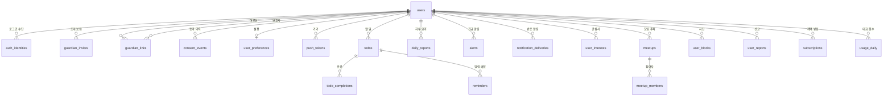

# DB 스키마 초안 (#3)

> 상태: **초안**. DB 종류는 #1 회의에서 정합니다. B 기술 조사([PR #64](https://github.com/Bae-Seung-Hwan/Senior_AI_companion/pull/64)의 `docs/research/b-stack.md`)에서 잠정 추천한 PostgreSQL 기준으로 썼습니다.
> SQL: [schema.sql](schema.sql). PostgreSQL 18에서 실제로 실행해 테이블 20개가 만들어지는 것과 제약 조건 9가지가 의도대로 막히는 것을 확인했습니다.

**범위**: #3의 B 몫 전체(회원·보호자·동의, 할 일·복약, 보호자 전송, 모임, 구독)입니다.
**A 몫인 대화 기록(#18)은 이 초안에 없습니다.** B 테이블은 `conversation_id`, `message_id`를 문자열로만 들고 있어서, A가 대화 테이블을 어떻게 설계해도 바꿀 필요가 없습니다.

## 관계도



## 테이블 한눈에 보기

| 영역 | 테이블 | 무엇을 저장하나 | 관련 |
| --- | --- | --- | --- |
| 회원·보호자 | `users` | 어르신·보호자 (`role`로 구분), 호칭, 동네 | #39 |
| | `auth_identities` | 로그인 수단 (카카오·애플·전화번호 등) | #4 |
| | `guardian_invites` | 보호자 초대 코드 | #40 |
| | `guardian_links` | 어르신 ↔ 보호자 연결 (여러 명, 해제 이력 남김) | #40 |
| | `consent_events` + 뷰 `current_consents` | **동의·철회 이력** (쌓기만 함) + 지금 유효한 동의 | #41, 명세 3·7 |
| | `user_preferences` | `time_hint` 기본 시각, 방해 금지 시간, 요약 발송 시각, 글씨·말 속도 | #43, 명세 1 |
| | `push_tokens` | 푸시 토큰 | #50 |
| 할 일·복약 | `todos` | 할 일·복약 (한 번 / 매일 / 매주) | #44, 명세 1 |
| | `todo_completions` | 회차별 완료 ("약 먹었어") | #44 |
| | `reminders` | 예약된 알림, 스케줄러가 꺼내 보냄 | #47 |
| 보호자 전송 | `daily_reports` | 하루 요약 (사용자·날짜당 하나) | #48, 명세 3 |
| | `alerts` | 긴급 알림 | #49, 명세 4 |
| | `notification_deliveries` | 누구에게 어떤 채널로 보냈는지 (푸시 실패 → 알림톡 대체 발송 연결) | #50 |
| 모임 | `user_interests` | 관심사 (대화에서 추출, 본인이 삭제 가능) | #53, 명세 2 |
| | `meetups`, `meetup_members` | 모임, 참여자 | #54, #55 |
| | `user_blocks`, `user_reports` | 차단, 신고 | #56 |
| 구독 | `subscriptions` | 구독 (혜택 받는 어르신 ≠ 결제자 자녀) | #59~#61 |
| | `usage_daily` | 하루 대화 횟수 | #58, 명세 6 |

## 설계에서 정한 것

### 1. 동의는 "현재 값"이 아니라 "이력"으로 저장
공유 범위(일정·건강·기분)와 긴급 알림 동의를 켜고 끌 때마다 `consent_events`에 한 줄씩 **쌓기만** 합니다. 지금 유효한 값은 뷰 `current_consents`(항목별 마지막 이벤트)로 읽습니다.
- 개인정보 원칙 "항목별 별도 동의, 언제든 철회"를 나중에 증명할 수 있음 (누가, 언제, 어떤 약관 버전에 동의했는지)
- **공유 범위는 본인만 바꿀 수 있게 DB에서 막았습니다** (`share_*`는 `actor_id = user_id`). 보호자가 원격 설정(#43)을 해도 공유 범위는 못 바꿉니다

### 2. 명세의 규칙을 DB 제약으로도 막음
| 명세 규칙 | DB에서 |
| --- | --- |
| 같은 `request_id`로 다시 보내면 새로 만들지 않음 | `todos`, `daily_reports`, `alerts`의 `request_id UNIQUE` |
| 반복도 날짜도 없으면 `MISSING_SCHEDULE` | `CHECK (date IS NOT NULL OR repeat_freq IS NOT NULL)` |
| `time`과 `time_hint`는 둘 중 하나 | `CHECK (time IS NULL OR time_hint IS NULL)` |
| 매주 반복에는 요일 필요 | `CHECK`로 요일 배열 필수 |
| 사용자·날짜당 요약 하나 | `daily_reports UNIQUE (user_id, date)` |
| 한 어르신에게 유효한 구독 하나 | 부분 유니크 인덱스 |

### 3. 정확한 위치는 저장하지 않음
모임 매칭은 **행정동 코드(`region_code`)** 단위로 합니다. 좌표가 필요해지면 그때 PostGIS를 검토합니다.

### 4. 민감 컬럼 표시
`schema.sql`에 `[민감]`으로 표시한 컬럼은 로그 금지, 암호화·보관 기간 정책 대상입니다.
- `todos.original_text`: 어르신이 한 말
- `daily_reports.section_health`: 건강 문단
- `alerts.evidence_text`: 긴급 알림 근거 발화

### 5. ID
DB에서는 숫자 ID(`bigint`)를 쓰고, API에서는 명세처럼 접두어를 붙여 보여줍니다 (`users.id = 123` ↔ `"u_123"`).

## 회의에서 정할 것

- [ ] **하루 요약을 어디에 저장할지**: A의 요약 배치(#29)도 "결과 저장"이 있어서 겹칩니다. 이 초안은 B의 `daily_reports` 하나에 저장하고 A는 명세 3으로 넘기는 안입니다
- [ ] 공유 범위를 **어르신 단위**로 둘지(이 초안), **보호자마다** 다르게 둘지 (예: 딸에게는 건강, 아들에게는 일정만)
- [ ] 민감 컬럼 **보관 기간** (예: 대화 원문 1년 뒤 삭제)과 암호화 방식 (DB 전체 암호화 / 컬럼 암호화)
- [ ] 탈퇴 시 처리: 개인정보는 지우고, 동의·발송·신고 이력은 법정 보관 기간만큼 남길지
- [ ] `time_hint` 기본 시각 (초안: 08:00 / 12:00 / 18:00 / 21:00)
- [ ] 구독 연동을 RevenueCat으로 하면 `store_original_transaction_id` 대신 RevenueCat 고객 ID를 저장 (#60)

## 직접 실행해 보기

```bash
createdb senior_ai_draft
psql -d senior_ai_draft -f docs/db/schema.sql
```
