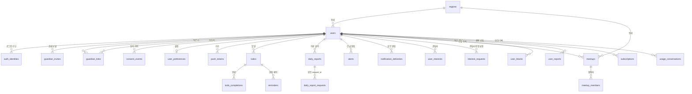

# DB 스키마 초안 (#3)

> 상태: **초안**. DB 종류는 #1 회의에서 정합니다. B 기술 조사([PR #64](https://github.com/Bae-Seung-Hwan/Senior_AI_companion/pull/64)의 `docs/research/b-stack.md`)에서 잠정 추천한 PostgreSQL 기준으로 썼습니다.
> SQL: [schema.sql](schema.sql). PostgreSQL 18에서 실제로 실행해 테이블 23개가 만들어지는 것과 제약 조건이 의도대로 막히는 것을 확인했습니다.
> 명세는 [PR #37](https://github.com/Bae-Seung-Hwan/Senior_AI_companion/pull/37) 초안(0b778ee) 기준입니다 (긴급 알림 두 번 호출, `time`·`time_hint` 둘 중 하나, 요약 `request_id` 기억).

**범위**: #3의 B 몫 전체(회원·보호자·동의, 할 일·복약, 보호자 전송, 모임, 구독)입니다.
**A 몫인 대화 기록(#18)은 이 초안에 없습니다.** B 테이블은 `conversation_id`, `message_id`를 문자열로만 들고 있어서, A가 대화 테이블을 어떻게 설계해도 바꿀 필요가 없습니다.

## 관계도



## 테이블 한눈에 보기

| 영역 | 테이블 | 무엇을 저장하나 | 관련 |
| --- | --- | --- | --- |
| 회원·보호자 | `users` | 어르신·보호자 (`role`로 구분), 호칭, 동네 | #39 |
| | `auth_identities` | 로그인 수단 (카카오·애플·전화번호 등) | #4 |
| | `guardian_invites` | 보호자 초대 코드 (카톡 공유 링크 또는 알림톡용 전화번호) | #40 |
| | `guardian_links` | 어르신 ↔ 보호자 연결 (여러 명, 해제 이력 남김) | #40 |
| | `consent_events` + 뷰 `current_consents` | **동의·철회 이력** (쌓기만 함) + 지금 유효한 동의 | #41, 명세 3·7 |
| | `user_preferences` | `time_hint` 기본 시각, 방해 금지 시간, 요약 발송 시각, 글씨·말 속도 | #43, 명세 1 |
| | `push_tokens` | 푸시 토큰 | #50 |
| 할 일·복약 | `todos` | 할 일·복약 (한 번 / 매일 / 매주) | #44, 명세 1 |
| | `todo_completions` | 회차별 완료 ("약 먹었어") | #44 |
| | `reminders` | 예약된 알림, 스케줄러가 꺼내 보냄 | #47 |
| 보호자 전송 | `daily_reports` | 하루 요약 (사용자·날짜당 하나) | #48, 명세 3 |
| | `daily_report_requests` | 요약을 만든 `request_id` 전부 (덮어써도 이전 값 기억) | #48, 명세 3 |
| | `alerts` | 긴급 알림 (감지 즉시 `pending` → 어르신 선택으로 갱신) | #49, 명세 4 |
| | `notification_deliveries` | 누구에게 어떤 채널로 보냈는지 (푸시 실패 → 알림톡 대체 발송 연결) | #50 |
| 모임 | `user_interests` | 관심사 (대화에서 추출, 본인이 삭제 가능). 지운 행도 남김 | #53, 명세 2 |
| | `interest_requests` | 관심사 반영 요청과 항목별 결과 (`request_id` 재시도용) | #53, 명세 2 |
| | `regions` | 행정동 코드 → 이름 | #54, 명세 5 |
| | `meetups`, `meetup_members` | 모임, 참여자 | #54, #55 |
| | `user_blocks`, `user_reports` | 차단, 신고 | #56 |
| 구독 | `subscriptions` | 구독 (혜택 받는 어르신 ≠ 결제자 자녀) | #59~#61 |
| | `usage_conversations` + 뷰 `usage_daily` | 대화 기록 (대화 하나에 한 줄, `request_id`로 중복 방지) + 하루 대화 횟수 | #58, 명세 6 |

## 설계에서 정한 것

### 1. 동의는 "현재 값"이 아니라 "이력"으로 저장
공유 범위(일정·건강·기분)와 긴급 알림 동의를 켜고 끌 때마다 `consent_events`에 한 줄씩 **쌓기만** 합니다. 지금 유효한 값은 뷰 `current_consents`(항목별 마지막 이벤트)로 읽습니다.
- 개인정보 원칙 "항목별 별도 동의, 언제든 철회"를 나중에 증명할 수 있음 (누가, 언제, 어떤 약관 버전에 동의했는지)
- **공유 범위는 본인만 바꿀 수 있게 DB에서 막았습니다** (`share_*`는 `actor_id = user_id`). 보호자가 원격 설정(#43)을 해도 공유 범위는 못 바꿉니다

### 2. 명세의 규칙을 DB 제약으로도 막음
| 명세 규칙 | DB에서 |
| --- | --- |
| 같은 `request_id`로 다시 보내면 새로 만들지 않음 | `todos.request_id`, `alerts.request_id`·`response_request_id` UNIQUE, `daily_report_requests` PK |
| 요약을 덮어써도 이전 `request_id`는 중복으로 처리 | `daily_report_requests`에 요청마다 한 줄 (요약 하나에 여러 줄) |
| 긴급 알림 선택은 한 번만, `pending`이면 선택 시각 없음 | `CHECK ((user_response = 'pending') = (responded_at IS NULL))` |
| `mood_level` 필수 | `daily_reports.mood_level NOT NULL` |
| 반복도 날짜도 없으면 `MISSING_SCHEDULE` | `CHECK (date IS NOT NULL OR repeat_freq IS NOT NULL)` |
| `time`과 `time_hint`는 둘 중 하나 | `CHECK (time IS NULL OR time_hint IS NULL)` |
| 매주 반복에는 요일 필요 | `CHECK`로 요일 배열 필수 |
| 사용자·날짜당 요약 하나 | `daily_reports UNIQUE (user_id, date)` |
| 한 어르신에게 유효한 구독 하나 | 부분 유니크 인덱스 |
| 같은 대화를 두 번 세지 않음 (명세 6-2) | `usage_conversations.request_id` PK |
| 관심사 반영 재시도는 처음 결과 그대로 (명세 2) | `interest_requests.request_id` PK + `results` |
| 관심사 이름 1~20자 (명세 2 `INVALID_INTEREST_NAME`) | `CHECK (length(name) BETWEEN 1 AND 20)` |
| 같은 관심사는 하나만 | `user_interests_active` 부분 유니크 인덱스 (지운 것 제외) |

### 3. 정확한 위치는 저장하지 않음
모임 매칭은 **행정동 코드(`region_code`)** 단위로 합니다. 좌표가 필요해지면 그때 PostGIS를 검토합니다.
행정동 이름(명세 5 `region_name`)은 `regions` 표에서 가져옵니다. 예전에는 `users.region_name`에 이름을 따로 들고 있었는데, 모임에도 이름이 필요해져서 표 하나로 모았습니다 (행정동 이름이 바뀌어도 한 곳만 고치면 됨).

### 4. 민감 컬럼 표시
`schema.sql`에 `[민감]`으로 표시한 컬럼은 로그 금지, 암호화·보관 기간 정책 대상입니다.
- `todos.original_text`: 어르신이 한 말
- `daily_reports.section_health`: 건강 문단
- `alerts.evidence_text`: 긴급 알림 근거 발화
- `user_interests.original_text`: 관심사를 뽑은 어르신의 말 (저장할지는 회의에서)

### 5. 긴급 알림 동의는 "근거 발화 공유"만 끌 수 있음
`consent_type = 'emergency_alert'`는 **긴급 알림 자체를 켜고 끄는 동의가 아닙니다.** 명세 4번대로 긴급 알림은 공유 범위·동의와 상관없이 항상 나갑니다. 이 동의로 끌 수 있는 것은 보호자 앱에서 근거 발화(`evidence_text`)를 보여 주는 것뿐입니다.

### 6. `notification_deliveries.subject_id`에는 FK가 없음
`subject_type`에 따라 `daily_reports`, `alerts`, `guardian_invites`, `reminders` 중 하나를 가리키기 때문에 FK 하나로 걸 수 없습니다. 발송 기록은 쌓기만 하는 로그라 대상이 지워져도 남아야 해서 FK가 없는 편이 맞다고 봤습니다. 대신 앱 코드에서 `(subject_type, subject_id)`로 대상을 찾고, 인덱스를 걸어 두었습니다. 채널별 테이블로 나누는 방법은 발송 종류가 늘면 다시 봅니다.

### 7. 보호자 초대는 두 가지 방식
`guardian_invites.invitee_phone`이 null이면 어르신 폰의 카톡 공유(링크)로 보낸 초대, 값이 있으면 알림톡 "보호자 초대" 템플릿으로 보낸 초대입니다. 가입 전 보호자의 전화번호라서 초대가 쓰이거나 만료되면 지웁니다.

### 8. 대화 횟수는 기록에서 셈
명세 6-2는 같은 `request_id`가 다시 오면 횟수를 늘리지 않아야 합니다. 하루 횟수만 저장하면 어떤 대화를 이미 셌는지 알 수 없어서, **대화마다 한 줄씩 `usage_conversations`에 쌓고 `usage_daily` 뷰로 셉니다.**
- `date`는 `started_at`을 사용자 시간대로 바꾼 날짜입니다. B 장애 뒤 늦게 기록돼도 대화한 날짜에 들어갑니다 (명세 6)
- 횟수를 따로 저장하지 않아 기록과 횟수가 어긋날 일이 없습니다. 사용자가 많아져 세는 게 느려지면 그때 횟수 테이블을 둡니다
- "아주 긴 대화를 나눠 셀지"가 회의에서 정해지면, 나눈 조각마다 `request_id`를 따로 받는 식으로 이 테이블을 그대로 씁니다

### 9. 명세 2·5에 맞춘 것 (#70)
- **관심사는 지워도 행을 남깁니다** (`removed_at`). 대화에서 온 같은 이름을 90일(임시) 안에 다시 넣지 않기 위해서입니다 (`recently_removed`). 화면에서 직접 다시 추가하면 새 행이 생깁니다
- `original_text`[민감]는 대화에서 온 관심사(`voice`)에만 들어가고, 저장할지는 회의(#68)에서 정합니다. 직접 추가한 관심사는 대화 정보가 비어 있어야 합니다 (CHECK)
- **신고로 이용이 정지된 사용자**는 `users.suspended_at`으로 표시합니다. 정지된 주최자의 모임은 명세 5 추천에서 뺍니다. 신고 접수 즉시 숨길지, 운영자 확인 후 숨길지는 회의(#68)에서 정합니다
- **모임 정원과 참여 인원은 주최자를 포함합니다.** 그래서 주최자도 모임을 만들 때 `meetup_members`에 한 줄 넣습니다
- 추천에서 빼는 조건(차단 관계, 탈퇴·정지한 주최자, 이미 참여한 모임)은 `user_blocks`, `users.deleted_at`·`suspended_at`, `meetup_members`로 거릅니다

### 10. ID
DB에서는 숫자 ID(`bigint`)를 쓰고, API에서는 명세처럼 접두어를 붙여 보여줍니다 (`users.id = 123` ↔ `"u_123"`).
모임은 `mt_` 접두어를 씁니다 (`meetups.id = 12` ↔ `"mt_12"`, `m_`은 `message_id`와 겹침, #70 제안).
**보호자도 `users`의 한 줄이라 같은 `u_` 접두어를 씁니다** (예: `u_789`). 역할은 `role` 컬럼과 API 필드 이름(`guardian_id`)으로 구분합니다 (B 제안, #67 명세 7 "ID 규칙").

## 회의에서 정할 것

- [ ] **하루 요약을 어디에 저장할지**: A의 요약 배치(#29)도 "결과 저장"이 있어서 겹칩니다. 이 초안은 B의 `daily_reports` 하나에 저장하고 A는 명세 3으로 넘기는 안입니다
- [ ] 공유 범위를 **어르신 단위**로 둘지(이 초안), **보호자마다** 다르게 둘지 (예: 딸에게는 건강, 아들에게는 일정만)
- [ ] 민감 컬럼 **보관 기간** (예: 대화 원문 1년 뒤 삭제)과 암호화 방식 (DB 전체 암호화 / 컬럼 암호화)
- [ ] 탈퇴 시 처리: 개인정보는 지우고, 동의·발송·신고 이력은 법정 보관 기간만큼 남길지
- [ ] `time_hint` 기본 시각 (초안: 08:00 / 12:00 / 18:00 / 21:00)
- [ ] 구독 연동을 RevenueCat으로 하면 `store_original_transaction_id` 대신 RevenueCat 고객 ID를 저장 (#60)

## 직접 실행해 보기

```bash
createdb senior_ai_draft
psql -d senior_ai_draft -f docs/db/schema.sql
```
